I'm Subhash — an MCA student at GITAM University in Visakhapatnam. Most of my time goes into Python and web development: writing code, reading docs, and building things that actually work. Curious by default, developer by practice.

I like software where the details behave — presence that updates the moment someone joins, interfaces that keep one visual rhythm, copy that says exactly what a product does and doesn't do yet. I care about building products end to end: the schema, the service, and the interface.

**→ [Portfolio](https://subashboina.vercel.app)** — the full story, designed properly.

---

## Selected work

### 01 · NOMI — Real-time messaging

A full-stack messaging application featuring private conversations, real-time messages, presence, typing indicators, read receipts, and persistent chat history.

`Next.js` · `TypeScript` · `FastAPI` · `PostgreSQL` · `SQLAlchemy`

**[Open live demo ↗](https://nomizen.vercel.app)** · Account required · Source private

### 02 · YO — Your Own AI

An AI study assistant designed to turn questions into conversations, with streamed explanations, persistent chat history, quizzes, and flashcards.

`Python` · `LLM API` · `Streaming` · `HTML` · `CSS` · `JavaScript`

**[Open live demo ↗](https://yozen.vercel.app)** · Source private

### 03 · LIGHT — AI voice assistant

A desktop voice assistant in development, exploring natural voice interaction and practical computer actions.

`Python` · `Voice interaction` · `Desktop automation`

---

## Technical focus

- **Languages:** Python · TypeScript · JavaScript · SQL
- **Frontend:** Next.js · React · HTML · CSS
- **Backend & data:** FastAPI · Flask · SQLAlchemy · PostgreSQL
- **Tools:** Git · GitHub · Vercel

---

## Connect

[Portfolio ↗](https://subashboina.vercel.app) · [LinkedIn ↗](https://www.linkedin.com/in/subhash-b-082565289/) · [Résumé ↗](https://subashboina.vercel.app/assets/subashresume.pdf) · [Email](mailto:subhashsubbu8374@gmail.com)
