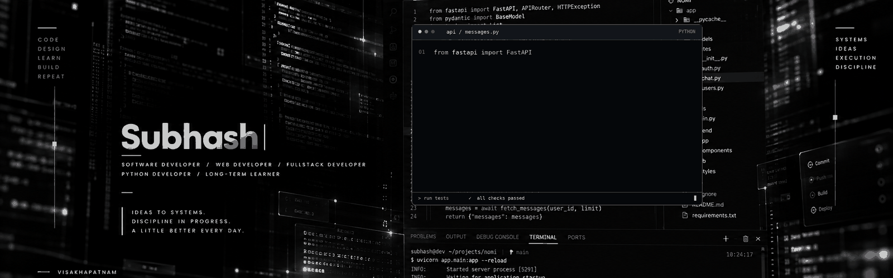

### SOFTWARE ENGINEERING · FULL-STACK DEVELOPMENT · AI

**I build software beyond the interface.**

Interested in the systems behind meaningful software.

MCA · GITAM University · Visakhapatnam

**→ [Portfolio ↗](https://subashboina.vercel.app)** — the full story, designed properly.

---

### 01 — Selected Work

Things I've designed, developed, and experimented with.

#### NOMI
**Real-time communication, built from the ground up.**

A full-stack messaging application focused on private conversations and real-time interaction. Built with a dedicated backend, persistent storage, and a modern web interface.

`Next.js` `TypeScript` `FastAPI` `PostgreSQL` `WebSockets`

[→ Live ↗](https://nomizen.vercel.app)

---

#### YO
**Your Own AI · An interactive study assistant.**

An AI-powered learning application built around contextual conversations, streamed responses, and interactive study tools. Includes persistent chat history, quizzes, flashcards, and specialized chat modes.

`React` `JavaScript` `Flask` `Turso` `Groq API` `OpenRouter`

[→ Live ↗](https://yozen.vercel.app)

---

#### LIGHT
**A voice-first desktop assistant.**

Exploring how natural language can become a practical way to interact with a computer. Combines speech transcription, LLM-powered task planning, and desktop actions in a cross-platform application.

`React` `TypeScript` `Rust` `Tauri` `Whisper` `Groq API`

*Currently in development.*

---

### 02 — Areas of Exploration

- **Full-stack systems** — application architecture, APIs, and data flow.
- **Real-time applications** — WebSockets, messaging, and live interaction.
- **AI applications** — LLM integration, contextual systems, and automation.
- **Desktop engineering** — voice interfaces and native application control.

---

### 03 — Technical Toolkit

**Languages**  
`Python` `JavaScript` `TypeScript` `C` `SQL`

**Frontend**  
`React` `Next.js` `HTML` `CSS` `Tailwind CSS` `Framer Motion`

**Backend & Databases**  
`FastAPI` `Flask` `REST APIs` `WebSockets` `PostgreSQL` `SQLite` `SQLAlchemy` `Turso`

**Tools & Platforms**  
`Git` `GitHub` `Vercel` `Railway` `Neon` `Tauri` `Rust`

**AI & Speech**  
`Groq` `OpenRouter` `Whisper`

---

---

[Portfolio ↗](https://subashboina.vercel.app) &nbsp;·&nbsp; [LinkedIn ↗](https://www.linkedin.com/in/subhash-b-082565289/) &nbsp;·&nbsp; [Email ↗](mailto:subhashsubbu8374@gmail.com)

Designed with curiosity. Built with purpose.

